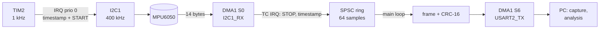

# NUCLEO-F446RE + MPU6050 — real-time IMU data acquisition

[](https://github.com/<your-user>/nucleo-f446re-imu-daq/actions/workflows/ci.yml)
-blue)


Bare-metal C++17 firmware that samples an **MPU6050** IMU at a fixed, hardware-timed rate (1 kHz by default),
reads it out with **I2C + DMA**, timestamps every sample with the **DWT cycle counter** and streams CRC-protected
binary frames over UART with DMA. Host tools in **Python and MATLAB** parse the stream and *measure* what the
firmware actually achieved: lost samples, sampling jitter, acquisition latency and static IMU noise (Allan deviation).

It is the data-acquisition layer I use as a base for sensor-fusion and navigation-filter experiments
(IMU preprocessing, GNSS/INS, EKF on the MCU).

## Highlights

- **No HAL, no RTOS, no heap.** Startup code, vector table, linker script, clock tree, I2C, DMA and UART written
  against the CMSIS register headers only. CI fails if `malloc`/`free` are linked in.
- **Hardware-timed sampling.** TIM2 at the core clock: one tick = exactly 84 000 cycles at 1 kHz, so the jitter measured
  in the log is the interrupt-latency variation itself.
- **Interrupt-driven I2C state machine + DMA data phase.** The CPU is busy for microseconds, not for the ~390 µs the transfer takes.
- **Lock-free SPSC ring buffer** between the DMA interrupt and the main loop (unit-tested with two real threads).
- **Compile-time budget checks.** `static_assert`s reject configurations where the I2C transaction exceeds 80 % of the
  period or the UART link is overloaded.
- **Built to be verified.** Every sample carries a sequence number, two timestamps and a drop counter; a CRC-16 lets
  the host resynchronise after corruption. `lost frames = firmware drops + CRC errors` is checked by the tests.
- **Firmware and host agree by test.** A golden frame vector is checked by both the C++ and the Python tests.
- **CI:** firmware cross-build, C++ host tests, Python tests, MATLAB scripts run under Octave, clang-format.

## Architecture



More in [docs/architecture.md](docs/architecture.md) (state machine, priorities, timing budget, design decisions)
and [docs/protocol.md](docs/protocol.md) (frame format).

## Hardware

| MPU6050 (GY-521) | NUCLEO-F446RE |
|---|---|
| VCC | 3V3 |
| GND | GND |
| SCL | PB8 (D15) |
| SDA | PB9 (D14) |
| AD0 | GND (address 0x68) |

The serial stream goes through the on-board ST-LINK virtual COM port (USART2, PA2). Details and troubleshooting:
[docs/hardware-setup.md](docs/hardware-setup.md).

## Quick start

```bash
# 1. Build and flash (Ubuntu / WSL; needs network access once for the CMSIS headers)
sudo apt install cmake ninja-build gcc-arm-none-eabi openocd
cmake --preset firmware
cmake --build --preset firmware
cmake --build --preset firmware --target flash          # or drag build/firmware/firmware/imu_daq.bin onto the NODE_F446RE drive

# 2. Capture 10 minutes and analyse (Python)
pip install -r tools/requirements.txt
cd tools
python -m imu_daq capture --port /dev/ttyACM0 --duration 600 --out ../data/run.bin     # COM5 on Windows
python -m imu_daq analyze ../data/run.bin --rate 1000 --out ../results/run
```

```matlab
% 2b. Same analysis in MATLAB
addpath('tools/matlab');
report = analyze_log('data/run.bin', 1000);    % rate [Hz], cpu clock, accel/gyro full-scale are optional
```

No board at hand? `python -m imu_daq simulate --out ../data/synthetic.bin` writes a **synthetic** log in the same
format, to try the tools. Synthetic numbers are not results.

### Configuration

Pass to `cmake --preset firmware`, e.g. `-DSAMPLE_RATE_HZ=200`.

| Option | Default | Meaning |
|---|---|---|
| `SAMPLE_RATE_HZ` | 1000 | must divide 84 MHz (1000, 500, 250, 200, 100, 50 ...) |
| `I2C_CLOCK_HZ` | 400000 | 1 kHz needs 400 kHz; the build fails otherwise |
| `UART_BAUD` | 460800 | 32-byte frames: 1 kHz needs ≥ 400 kbaud |
| `USE_HSE_BYPASS` | ON | 8 MHz ST-LINK MCO as PLL source, falls back to HSI (the banner shows `clk=HSE` or `clk=HSI`); OFF = HSI only |
| `MPU_ACCEL_FS_SEL` / `MPU_GYRO_FS_SEL` | 0 / 0 | ±2 g / ±250 deg/s (tell `analyze` with `--accel-fs/--gyro-fs`) |

## Results

Measured on hardware: **to be added** — see the test plan and the table to fill in
[docs/validation.md](docs/validation.md). Replace this paragraph with the real numbers and plots, e.g.

| Rate | Duration | Lost frames | Jitter rms | Jitter p-p | Latency max |
|---|---|---|---|---|---|
| 1 kHz | 10 min | _..._ | _... µs_ | _... µs_ | _... µs_ |

## Repository layout

```
firmware/
  include/     portable core, no hardware dependency: config, protocol (frame + CRC), SPSC ring buffer
  src/         startup + vector table, clock, GPIO/DWT helpers, UART+DMA, I2C, MPU6050, acquisition engine, main
  linker/      STM32F446RE linker script
tools/
  imu_daq/     Python package: parser, analysis (loss, jitter, latency, IMU, Allan), simulator, CLI
  matlab/      parse_log.m, analyze_log.m
tests/         GoogleTest (protocol, ring buffer, config), pytest, Octave cross-check, golden vector
docs/          architecture, protocol, hardware setup, validation plan
.github/       CI and release workflows
```

## Tests

```bash
cmake --preset host-tests && cmake --build --preset host-tests && ctest --preset host-tests   # C++ (native)
python -m pytest tests/python -q                                                              # Python
```

## Roadmap

- [ ] Data-ready interrupt (MPU6050 INT -> EXTI) to sample synchronously with the sensor
- [ ] Hardware input-capture timestamps instead of software timestamps at ISR entry
- [ ] Port the pipeline to FreeRTOS tasks and compare latency/jitter with this bare-metal version
- [ ] On-target filtering: fixed-size EKF / complementary filter on the sampled data
- [ ] IMU calibration (bias, scale, misalignment) from static captures

## License

MIT — see [LICENSE](LICENSE). CMSIS headers (Apache-2.0, STMicroelectronics/ARM) are fetched at build time and not redistributed here.