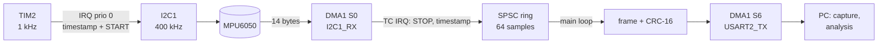
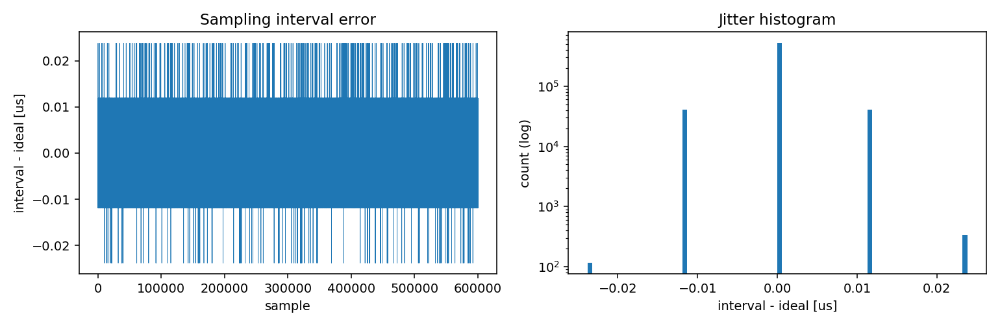
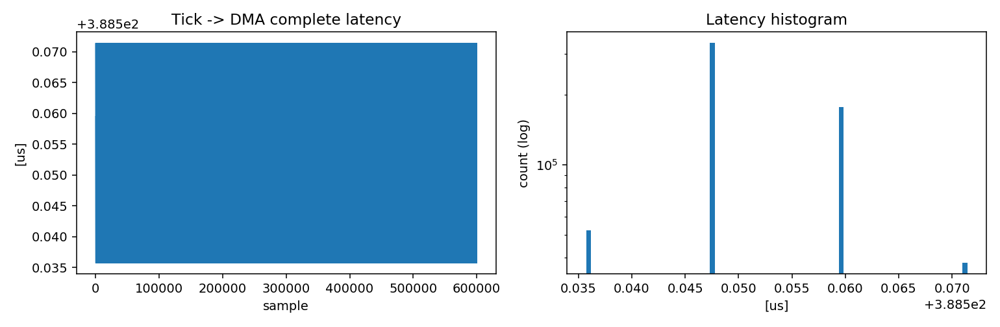

# NUCLEO-F446RE + MPU6050 — real-time IMU data acquisition

[](https://github.com/MatteoPolo5/STM32-IMU-project/actions/workflows/ci.yml)
-blue)


Bare-metal C++17 firmware that samples an **MPU6050** IMU at a fixed, hardware-timed rate (1 kHz by default),
reads it out with **I2C + DMA**, timestamps every sample with the **DWT cycle counter** and streams CRC-protected
binary frames over UART with DMA. Host tools in **Python and MATLAB** parse the stream and *measure* what the
firmware actually achieved: lost samples, sampling jitter, acquisition latency and static IMU noise (Allan deviation).

It is the data-acquisition layer I use as a base for sensor-fusion and navigation-filter experiments
(IMU preprocessing, GNSS/INS, EKF on the MCU).

## Highlights

- **No HAL, no RTOS, no heap.** Startup code, vector table, linker script, clock tree, I2C, DMA and UART written
  against the CMSIS register headers only. CI fails if `malloc`/`free` are linked in.
- **Hardware-timed sampling.** TIM2 at the core clock: one tick = exactly 84 000 cycles at 1 kHz, so the jitter measured
  in the log is the interrupt-latency variation itself.
- **Interrupt-driven I2C state machine + DMA data phase.** The CPU is busy for microseconds, not for the ~390 µs the transfer takes.
- **Lock-free SPSC ring buffer** between the DMA interrupt and the main loop (unit-tested with two real threads).
- **Compile-time budget checks.** `static_assert`s reject configurations where the I2C transaction exceeds 80 % of the
  period or the UART link is overloaded.
- **Built to be verified.** Every sample carries a sequence number, two timestamps and a drop counter; a CRC-16 lets
  the host resynchronise after corruption. `lost frames = firmware drops + CRC errors` is checked by the tests.
- **Firmware and host agree by test.** A golden frame vector is checked by both the C++ and the Python tests.
- **CI:** firmware cross-build, C++ host tests, Python tests, MATLAB scripts run under Octave, clang-format.

## Architecture



More in [docs/architecture.md](docs/architecture.md) (state machine, priorities, timing budget, design decisions)
and [docs/protocol.md](docs/protocol.md) (frame format).

## Hardware

| MPU6050 (GY-521) | NUCLEO-F446RE |
|---|---|
| VCC | 3V3 |
| GND | GND |
| SCL | PB8 (D15) |
| SDA | PB9 (D14) |
| AD0 | GND (address 0x68) |

The serial stream goes through the on-board ST-LINK virtual COM port (USART2, PA2). Details and troubleshooting:
[docs/hardware-setup.md](docs/hardware-setup.md).

## Quick start

```bash
# 1. Build and flash (Ubuntu; needs CMake >= 3.21 and network access once for the CMSIS headers)
sudo apt install ninja-build gcc-arm-none-eabi openocd      # CMake: apt on 22.04+, `pip install --user cmake` on 20.04
cmake --preset firmware
cmake --build --preset firmware
cmake --build --preset firmware --target flash          # or drag build/firmware/firmware/imu_daq.bin onto the NODE_F446RE drive

# 2. Capture 10 minutes and analyse (Python)
pip install -r tools/requirements.txt
cd tools
python -m imu_daq capture --port /dev/ttyACM0 --duration 600 --out ../data/run.bin     # COM5 on Windows
                                                                                          # (first second is discarded: --warmup)
python -m imu_daq analyze ../data/run.bin --rate 1000 --out ../results/run
```

```matlab
% 2b. Same analysis in MATLAB
addpath('tools/matlab');
report = analyze_log('data/run.bin', 1000);    % rate [Hz], cpu clock, accel/gyro full-scale are optional
```

Older toolchains (Ubuntu 20.04: CMake 3.16 without presets, OpenOCD 0.10, binutils 2.34) work with:

```bash
cmake -S . -B build/firmware -G Ninja -DCMAKE_TOOLCHAIN_FILE=cmake/arm-none-eabi.cmake \
      -DCMAKE_BUILD_TYPE=Release -DOPENOCD_INTERFACE=interface/stlink-v2-1.cfg
cmake --build build/firmware
```

No board at hand? `python -m imu_daq simulate --out ../data/synthetic.bin` writes a **synthetic** log in the same
format, to try the tools. Synthetic numbers are not results.

### Configuration

Pass to `cmake --preset firmware`, e.g. `-DSAMPLE_RATE_HZ=200`.

| Option | Default | Meaning |
|---|---|---|
| `SAMPLE_RATE_HZ` | 1000 | must divide 84 MHz (1000, 500, 250, 200, 100, 50 ...) |
| `I2C_CLOCK_HZ` | 400000 | 1 kHz needs 400 kHz; the build fails otherwise |
| `UART_BAUD` | 460800 | 32-byte frames: 1 kHz needs ≥ 400 kbaud |
| `USE_HSE_BYPASS` | ON | 8 MHz ST-LINK MCO as PLL source, falls back to HSI (the banner shows `clk=HSE` or `clk=HSI`); OFF = HSI only |
| `MPU_ACCEL_FS_SEL` / `MPU_GYRO_FS_SEL` | 0 / 0 | ±2 g / ±250 deg/s (tell `analyze` with `--accel-fs/--gyro-fs`) |

## Results

Measured on a NUCLEO-F446RE with a GY-521 (MPU6050), 1 kHz, I2C 400 kHz, 460800 baud, captured on a native Linux host.
Every number comes from `python -m imu_daq analyze` or from the firmware's own counters; the test plan, raw run log and
the open points are in [docs/validation.md](docs/validation.md).

| Metric | Result | Remark |
|---|---|---|
| Lost frames, end to end | **0 of 608 511** and **0 of 600 063** in two 10 min runs, 0 of 60 031 in each of three 60 s runs; 0 CRC errors | native Linux, fixed `capture` |
| Lost samples, firmware side | 0 overruns, 0 ring overflows, 0 I2C errors, 0 watchdog aborts in 958 398 samples | counters read with OpenOCD |
| Acquisition latency (tick to DMA done) | 388.6 µs mean, 388.7 µs max | 39 % of the 1 ms period; bus-time estimate is 387.5 µs |
| Timer-interrupt entry jitter | 0.004 µs rms, 0.036-0.048 µs peak-to-peak | CPU almost idle: this is *not* end-to-end sampling jitter |
| Sampling rate, internal RC oscillator (HSI) | about 1013-1015 frames/s | **+1.3 to +1.5 % fast** |
| Sampling rate, ST-LINK 8 MHz clock (HSE) | 999.984 frames/s over 600 s | **-16 ppm** against the PC clock (reference accuracy not checked) |
| Static accelerometer calibration (six positions) | abs(a) error +56.4 mg -> +3.9 mg in an orientation not used in the fit | one held-out orientation; the gyro bias differs by 0.05-0.12 deg/s between positions (cause not identified) |
| Gyro angle random walk | 0.23-0.26 deg/sqrt(h) (x, y, z) | from the Allan deviation; datasheet noise density corresponds to about 0.3 deg/sqrt(h) |
| Static IMU, uncalibrated | abs(a) = 1.062-1.073 g, gyro bias about [-1.0, -1.5, 0.27-0.41] deg/s | temperature 23.2 C |

What the measurements showed:

- The "measured rate" printed by `analyze` compares the hardware timer with the cycle counter, which share one clock, so it
  cannot see a wrong clock. The +1.3 % error of the RC oscillator only appeared when the frame count was compared with the
  host's wall clock. Feeding the PLL from the ST-LINK clock removed it, and that is now the default build.
- The latency matches the I2C transaction time at 400 kHz, so the DMA/interrupt path adds almost nothing to it.
- A first set of captures through a virtualised USB path lost 0.13 % of the frames (79 of 60 793) while the firmware
  counters stayed at zero. The losses did not reappear on a native Linux host (60 s and 10 min), which is consistent with
  that path being the cause but does not prove it: one board, one PC.
- The first frames of a capture can be stale data left in the ST-LINK buffers; `capture` now discards the first second.
- The static accelerometer error (+62 to +73 mg) and the gyro bias drift between sessions by more than the repeatability
  criterion set in the test plan, so absolute accuracy needs a calibration step (see roadmap).

Plots from the 10 min run (600 063 frames at 1 kHz), produced by `python -m imu_daq analyze`:




Not verified yet: accuracy of the PC clock used as time reference, jitter with a logic analyser, behaviour of a stalled
main loop, gyro bias instability (10 min is too short to reach the noise floor).

### Noise figures and static calibration

`analyze` also prints, per gyro axis, the angle random walk and the bias instability read from the Allan deviation, and
says when the data are too short for the latter. `calibrate` fits an accelerometer offset and sensitivity from six static
captures (one per axis direction) and the gyro bias, and checks the result on a capture that was not used in the fit:

```bash
python -m imu_daq calibrate --xp xp.bin --xn xn.bin --yp yp.bin --yn yn.bin --zp zp.bin --zn zn.bin \
       --validate held_out.bin --out calibration.json
```

MATLAB: `calibrate_six_position(means)`, `allan_deviation(x, rate)` and `allan_summary(tau, adev)` in `tools/matlab`.
Offset and per-axis sensitivity only; misalignment and gyro scale factor are not estimated.

## Repository layout

```
firmware/
  include/     portable core, no hardware dependency: config, protocol (frame + CRC), SPSC ring buffer
  src/         startup + vector table, clock, GPIO/DWT helpers, UART+DMA, I2C, MPU6050, acquisition engine, main
  linker/      STM32F446RE linker script
tools/
  imu_daq/     Python package: parser, analysis (loss, jitter, latency, IMU, Allan), simulator, CLI
  matlab/      parse_log.m, analyze_log.m
tests/         GoogleTest (protocol, ring buffer, config), pytest, Octave cross-check, golden vector
docs/          architecture, protocol, hardware setup, validation plan
.github/       CI and release workflows
```

## Tests

```bash
cmake --preset host-tests && cmake --build --preset host-tests && ctest --preset host-tests   # C++ (native)
python -m pytest tests/python -q                                                              # Python
```

## Roadmap

- [ ] Data-ready interrupt (MPU6050 INT -> EXTI) to sample synchronously with the sensor
- [ ] Hardware input-capture timestamps instead of software timestamps at ISR entry
- [ ] Port the pipeline to FreeRTOS tasks and compare latency/jitter with this bare-metal version
- [ ] On-target filtering: fixed-size EKF / complementary filter on the sampled data
- [x] IMU static calibration (offset, sensitivity, gyro bias); misalignment and gyro scale factor still open

## License

MIT — see [LICENSE](LICENSE). CMSIS headers (Apache-2.0, STMicroelectronics/ARM) are fetched at build time and not redistributed here.