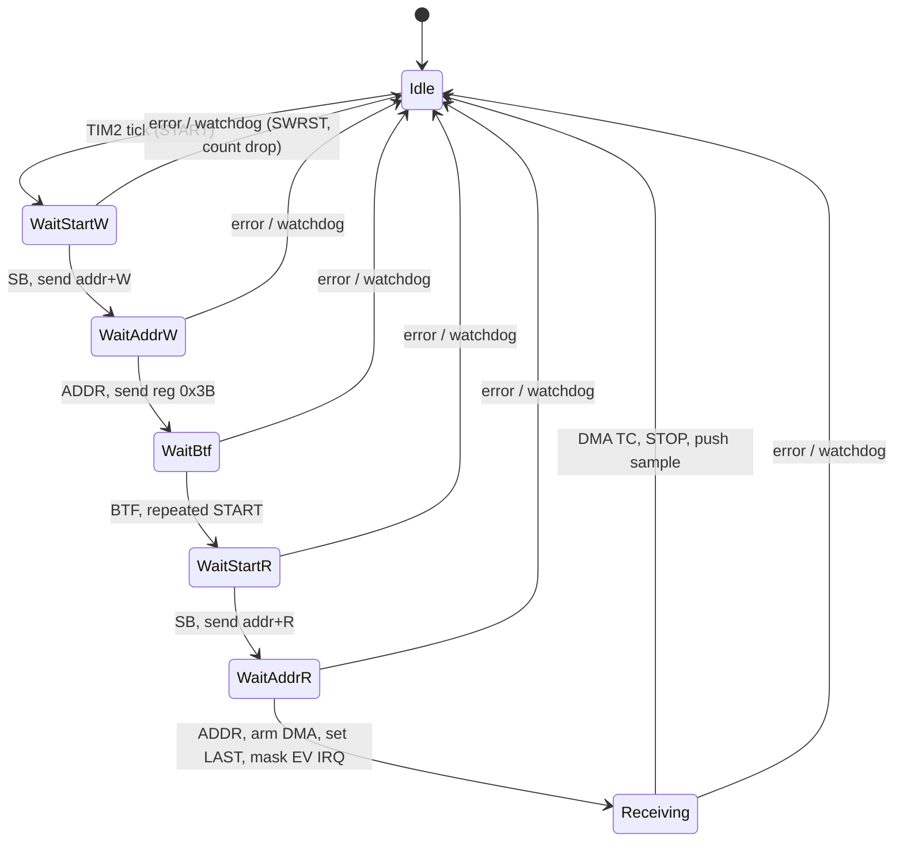

# Architecture

## Data path

```mermaid
flowchart LR
    TIM["TIM2<br/>1 kHz update event"] -->|IRQ prio 0<br/>timestamp + START| I2C["I2C1 master<br/>400 kHz"]
    I2C -->|"EV IRQ (state machine)<br/>addr+W, reg 0x3B, RESTART, addr+R"| MPU[("MPU6050")]
    MPU -->|14 bytes| DMA1["DMA1 Stream0<br/>I2C1_RX"]
    DMA1 -->|"TC IRQ<br/>STOP, timestamp"| RING["SPSC ring<br/>64 samples"]
    RING -->|main loop| PACK["frame packer<br/>CRC-16"]
    PACK --> DMA2["DMA1 Stream6<br/>USART2_TX"]
    DMA2 --> PC["PC<br/>(ST-LINK VCP)"]
```

The CPU is involved only at the edges of a transfer (a few microseconds per event); the 14 data
bytes and the 32-byte frames are moved by DMA.

## Interrupt priorities

| IRQ | Priority | Why |
|---|---|---|
| TIM2 | 0 (highest) | the timestamp it captures must have minimal jitter |
| I2C1_EV / I2C1_ER / DMA1_Stream0 | 1 | same level on purpose: they never preempt each other, so the shared state machine needs no locks |
| DMA1_Stream6 (UART) | 3 | not time-critical, only releases the TX buffer |
| main loop | - | UART drain, watchdog, LED |

## I2C transaction state machine

If a tick fires while the state is not `Idle`, the sample is dropped and counted (`overruns`); the sequence
number still advances so the loss is visible in the log.

## Timing budget (defaults: 1 kHz, 400 kHz I2C, 460800 baud)

| Item | Value | Budget |
|---|---|---|
| sampling period | 1000 µs | - |
| I2C transaction | 155 bit-times -> ~388 µs | < 80 % of the period (`static_assert`) |
| UART load | 32 B x 1000 Hz = 32 kB/s | 69 % of 46.08 kB/s (`static_assert` < 80 %) |
| ring buffer | 64 samples | 64 ms of slack if the main loop stalls |

`config.hpp` rejects impossible combinations at compile time, e.g. `-DI2C_CLOCK_HZ=100000` with the default
1 kHz rate fails to build.

## Design decisions

* **No dynamic allocation.** All buffers are static; the CI fails if `malloc`/`free`/`_sbrk` appear in the image.
* **Time base is the hardware timer, not the loop.** TIM2 counts the core clock (PSC = 0), so one tick is exactly
  84 000 DWT cycles at 1 kHz and the jitter of the log is a direct measurement of interrupt latency variation.
* **Interrupt-driven address phase + DMA data phase.** Polling would block the CPU for ~400 µs per sample.
  The STM32F4 I2C peripheral needs software for START / repeated START / address phases; only the data phase can be
  moved by DMA, so the address phase is a small interrupt-driven state machine.
* **Event IRQ masked during the DMA phase.** With `BTF` pending the I2C event interrupt would retrigger forever.
* **Raw payload on the wire.** Keeps the ISR short and lets the host choose scaling and ranges.
* **Portable core is host-tested.** `protocol.hpp`, `ring_buffer.hpp` and `config.hpp` have no hardware
  dependency; `tests/` runs them natively, including a two-thread stress test of the ring buffer.
* **Bare-metal startup written from scratch** (vector table, linker script, `Reset_Handler`): only the CMSIS register
  headers are fetched, no HAL.

## Known limitations / ideas

* The MPU6050 samples internally at 1 kHz, asynchronously to TIM2: at 1 kHz readout you will occasionally see a repeated
  or skipped sensor sample. Using the sensor's data-ready interrupt (INT pin -> EXTI) would remove this.
* Timestamps are taken in software at ISR entry, not by hardware input capture.
* Default clock source is the internal HSI (±1 % absolute accuracy). Jitter is unaffected (same clock domain), but absolute
  time is. `-DUSE_HSE_BYPASS=ON` uses the 8 MHz ST-LINK MCO if it is available.
